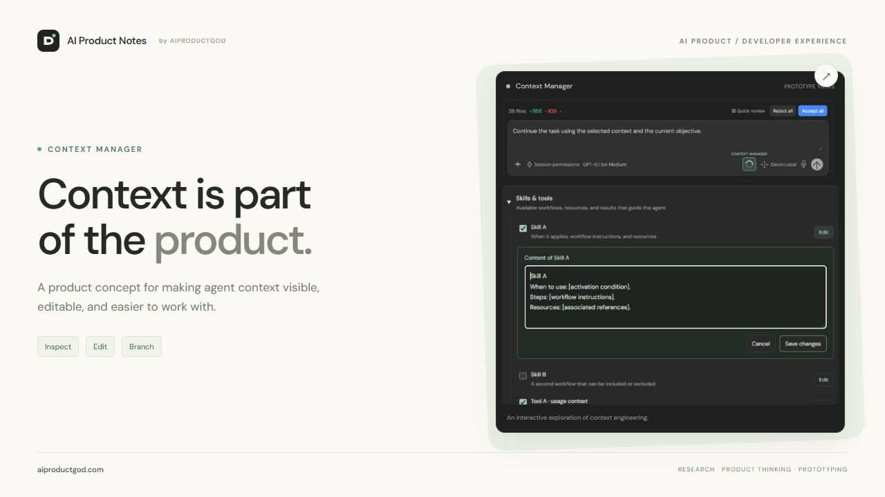
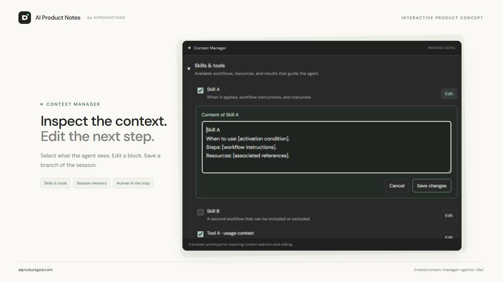
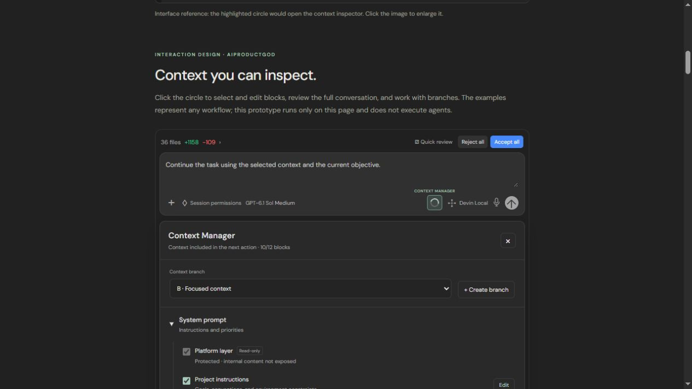
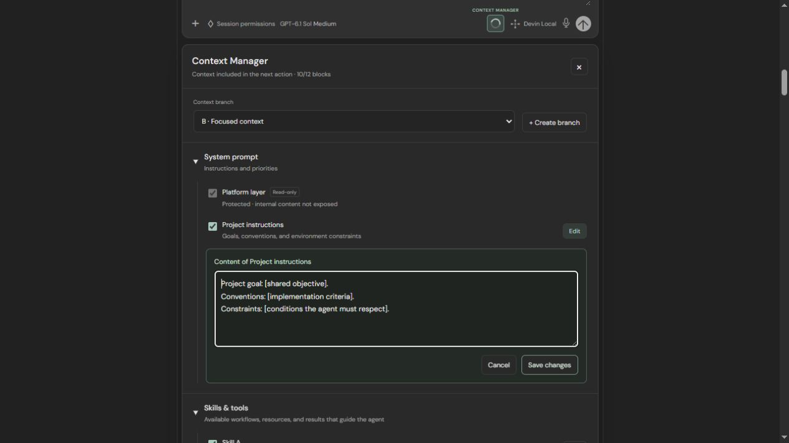
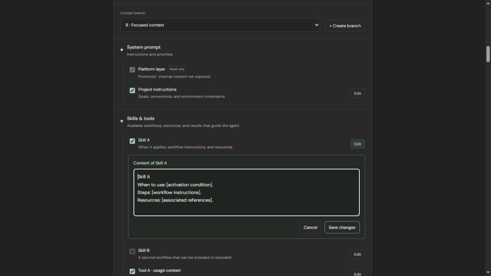
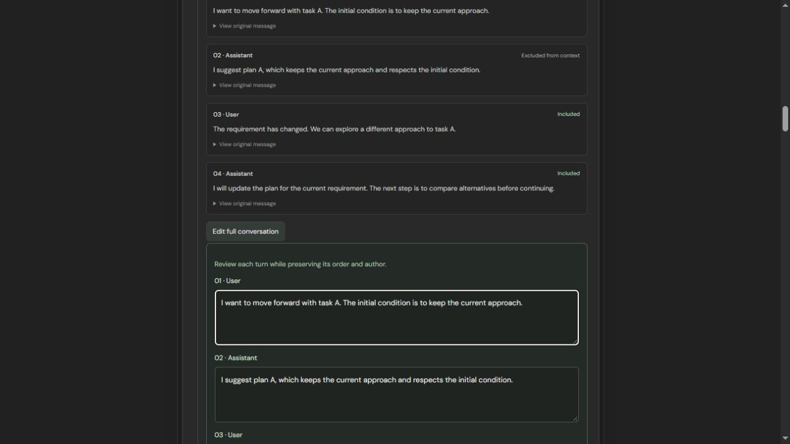
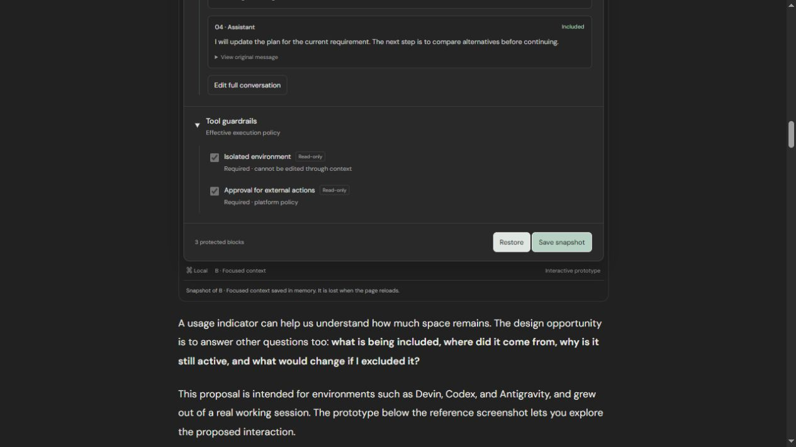

# Context Manager
### Making context engineering a product experience.

**AI Product Design · Feature concept · UI/UX · Agentic development**

An independent product design case study exploring a new feature for agentic IDEs: an interface that helps people understand, select, edit, and branch the context guiding an AI agent's next action.

**[Explore the interactive prototype](https://aiproductgod.com/notes/context-manager-agentic-ide/#context-demo)** · **[Read the full proposal](https://aiproductgod.com/notes/context-manager-agentic-ide/)**

| At a glance | |
| --- | --- |
| Product opportunity | Make session context understandable and actionable at the point of use. |
| Starting point | A working session in Devin and its circular context indicator. |
| Design focus | Feature definition, information architecture, interaction design, UI, and human control. |
| Deliverables | Product proposal, interactive browser prototype, and visual walkthrough. |
| Stage | Concept exploration; usability and outcome evaluation remain to be conducted. |

## 1. Product opportunity

A coding agent works with more than the latest prompt. Project instructions, skills, tool outputs, and previous decisions all influence what it does next.

When a requirement changes, an earlier assumption may still shape its behavior. A user can see the result but may struggle to identify which piece of context needs attention.

**How might we help people inspect and adjust the context behind the next agent action, without adding friction to every interaction?**

A usage indicator already provides a useful entry point. This proposal explores turning it into a control surface that answers four questions:

- What information is included?
- Where did it come from?
- Can I select or edit it?
- How can I explore another context variant while preserving the original?

## 2. Feature concept

Clicking the circular indicator opens **Context Manager**, a grouped tree of context blocks. Checkboxes control inclusion; a separate **Edit** action opens the content of an editable block.

The distinction matters: removing information and correcting information are different user intentions.

The feature also introduces **Context Branches**: independent variants of a session's context, with their own selections, edits, prompt, and snapshots.

## 3. User scenario: a decision has changed

Imagine a development session where the user initially asks the agent to preserve an existing API. Later, migration becomes acceptable, but the agent continues working around the earlier constraint.

With Context Manager, the user could:

1. Open the inspector and review the session history.
2. Locate the earlier decision and inspect its inclusion status.
3. Create a context branch, preserving the reference state.
4. Edit the relevant conversation variant or exclude an outdated block.
5. Save a snapshot before continuing with the updated context.

This scenario illustrates the intended interaction. It is not a measured result from an agent run.

## 4. Information architecture

| Context group | What the user needs to understand | Proposed interaction |
| --- | --- | --- |
| **System prompt & instructions** | Which instruction layers apply, their source, and what can be changed. | Inspect project guidance; select or edit supported blocks. Protected platform layers remain read-only. |
| **Skills & tools** | Available workflows, usage context, and retained outputs. | Select relevant blocks and edit their branch-specific content. Distinguish tool availability from context inclusion. |
| **Session memory** | The order, author, and inclusion status of visible messages. | Review or edit individual messages and the full conversation variant; keep originals available. |
| **Tool guardrails** | Effective execution limits and mandatory approval boundaries. | Inspect protected policies. Context edits never grant additional permissions. |

## 5. UI & interaction walkthrough

### Open the inspector and choose a branch

The context circle remains a compact entry point in the composer. The branch selector identifies which variant is active; creating a branch copies the current state for independent exploration.

### Inspect instructions

Editable project instructions sit alongside a visibly protected platform layer. The interface separates what users can change from what they can only inspect.

### Select and edit skills and tools

Checkboxes answer whether a block participates. Edit controls answer what that block contains. Skill A and Skill B are generic examples, representing any workflow rather than prescribing a specific skill.

### Review the conversation

Excluded messages remain visible in the history. Users can edit a message or review the conversation together, while retaining original messages for reference. Changes belong to the active branch.

### Check boundaries and save a snapshot

Required guardrails remain protected. Snapshots preserve the selected blocks, edited content, and prompt; restoring one recovers that state in its branch.

## 6. Design decisions and tradeoffs

- **Progressive disclosure:** keep the composer simple; expose detail when someone needs to investigate or intervene.
- **Separate selection from editing:** make inclusion and content correction distinct actions.
- **Preserve context history:** excluding a message from the next action should not erase the original exchange.
- **Make branch ownership clear:** edits and snapshots belong to an identifiable variant.
- **Distinguish context from permissions:** a checklist must never imply that mandatory protections can be disabled.
- **Expose uncertainty:** visible history, compacted summaries, and dynamically retrieved information are different sources of context. A production design would need to represent those differences and dependencies.

## 7. Prototype scope and boundaries

The interactive browser prototype demonstrates selection, editing, conversation variants, branches, and snapshots. Its state lasts for the current visit and is lost on reload.

The proposed feature is not integrated into Devin, Codex, or Antigravity. The prototype does not execute agents, expose hidden system instructions, change service permissions, or measure model performance. Agent runs and output comparison are outside the current prototype.

Devin's composer is the reference for the entry point. This is an independent exploration, without affiliation with or endorsement by the products discussed.

## 8. Validation plan

**Hypothesis:** making context inspectable and editable could reduce the effort required to diagnose context-related errors and support more precise human intervention.

An initial usability study would ask participants to find an outdated decision, create a branch, adjust the relevant context, and explain what the next action would use.

| Question | Evidence to collect |
| --- | --- |
| Can users find the relevant context? | Task completion, time to locate the block, and incorrect selections. |
| Do they understand the controls? | Whether they can explain selection, editing, branch scope, and protected layers. |
| Can they recover from a change? | Ability to inspect originals and restore a snapshot. |
| Does the feature improve agent outcomes? | In a later integrated study: task success, regressions, correction time, cost, and latency. |

Agent evaluations would require equivalent repository states, models, tools, and execution environments, with repeated runs. A visual context tree alone does not guarantee reproducibility or better outcomes.

**No usability or performance results are claimed for this concept.**

## 9. Product design takeaway

Context engineering is also an interaction design problem. As agents take on more work, people need understandable ways to see what guides them and intervene at a specific decision.

This case study connects a friction point in an existing workflow with a feature proposal, UI/UX decisions, a prototype, and a plan for validation. The prototype supports communicating and exploring the design; the focus of this portfolio entry is the product experience.

## Author

**Tomas Fagoaga · AIPRODUCTGOD**

AI Product Design · Context Engineering · Agentic Development

[LinkedIn](https://www.linkedin.com/in/tomas-fagoaga-9b1874294/) · [AI Product Notes](https://aiproductgod.com/)

Interested in opportunities to design better products and experiences for collaboration between people and AI agents.
